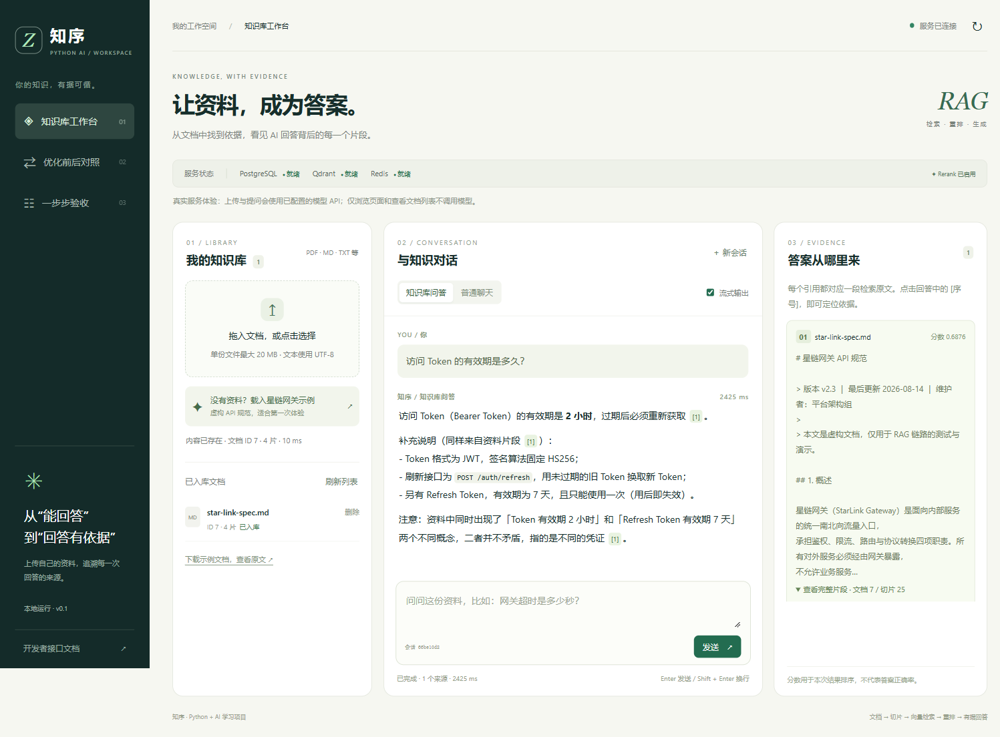
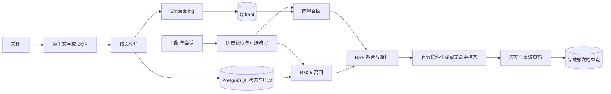

# 知序 · python-ai

基于 Python 的知识库问答项目：上传文本、PDF 或文字图片，系统完成解析/OCR、切片和向量化，结合 **BM25 + 向量混合检索、RRF 融合与 Rerank** 找到资料，再生成带来源和页码的回答。

项目提供同源网页工作台、REST/SSE 接口及 MCP Server，并接入 PostgreSQL 会话检查点、Langfuse 问答追踪、Alembic 迁移和一个实际训练的本地问题分类器。适合学习和展示 Python 后端、RAG 与工程可靠性，不宣称生产级平台或大模型微调已经完成。



## 可以做什么

| 能力 | 具体行为 |
| --- | --- |
| 文档管理 | 点击或拖拽上传；文件大小限制、SHA-256 去重、状态展示、删除文档及关联向量 |
| 文字与 OCR | UTF-8 文本、原生 PDF、图片与扫描 PDF；扫描页本地识别，引用保留物理页码 |
| 混合检索 | BM25 补充错误码/路径等词项召回，Qdrant 提供语义召回，RRF 按排名融合 |
| 重排与降级 | bge-reranker 精排；超时、无效/不完整响应时回退有效候选 |
| 追问改写 | 有历史的知识库追问补全主语，校验格式/标识，超时或不合格时用原问题；网页显示实际检索问题 |
| 有据回答 | 命中片段进入上下文，返回文档/片段/页码；无命中固定拒答，不调用生成模型 |
| 流式与普通聊天 | SSE 逐段输出或一次性返回；普通聊天不做知识库检索；中断/失败不保存半截回答 |
| 会话记忆 | LangGraph 官方 PostgreSQL Checkpointer；同一编号跨服务重启读取，RAG/CHAT 隔离、轮次裁剪与 TTL |
| 调用追踪 | Langfuse Cloud 记录问答、检索、生成及记忆读写；默认不上传完整正文，上报失败不阻断问答 |
| 数据库迁移 | Alembic 显式管理业务表；旧库结构比对、备份后接管，启动只检查版本 |
| 本地模型训练 | 字符 TF-IDF + 逻辑回归主题分类器；独立环境训练，JSON/NumPy 推理，低置信度显示未确定 |
| MCP | 向兼容客户端提供知识库搜索、文档列表和受限本地文件入库工具 |
| 项目间问答接入 | `zhixu.qa.v1` 版本化 HTTP 接口、Bearer 密钥、按项目区分会话；返回答案、来源页码和追踪信息 |
| 故障恢复 | 同内容操作数据库锁、FAILED 状态、写入补偿和检索状态复查，避免失败/删除资料继续引用 |

### 实际案例

- **精确编号**：上传星链网关示例后问 `42901`，可找到触发限流及 `Retry-After` 建议。旧版仅向量召回在当次相同语料对照中无命中；不据此宣称所有题都更好。
- **上下文追问**：先问“访问 Token 的有效期是多久？”，再问“那刷新用的呢？”，第二轮尝试补全 Refresh Token，答案依据为 7 天、一次使用。
- **扫描资料**：上传 `data/samples/ocr/crane-mixed.pdf`，问 `CRANE-18743 对应的图像服务端口是多少？`，答案为 18743，引用第 2 页。
- **持久记忆**：普通聊天保存代号后真正重启服务，同一会话、模式及有效期内仍可回忆；网页不持久化聊天正文，只保留编号。
- **删除验收**：删除自己的临时资料，新建会话再问，引用不再包含该文档。其他重复文件仍可命中，不等于删除失败。

## 技术栈与数据流

| 层次 | 实际使用 |
| --- | --- |
| Python 与后端 | Python 3.14、FastAPI、Pydantic Settings、async/await、异步生成器、SSE |
| 模型 API | DeepSeek 对话；硅基流动 BAAI/bge-m3 向量和 bge-reranker-v2-m3 重排 |
| 检索 | Qdrant 原生客户端、rank_bm25 BM25Plus(delta=0)、RRF、LangChain 文本切分与 LLM 封装 |
| 持久化 | PostgreSQL 17、SQLAlchemy/asyncpg、Alembic；psycopg 官方 saver 管检查点 |
| 状态与追踪 | LangGraph StateGraph、PostgreSQL Checkpointer、Langfuse；Redis 保留可选旧记忆后端 |
| 文件处理 | pypdf、PDFium/pypdfium2、Pillow、本地 Tesseract CLI |
| 训练与推理 | 独立 Python 3.12 + scikit-learn；主环境 NumPy 读取 JSON 参数 |
| 工程验证 | uv 锁依赖、Ruff、pytest、Node SSE 测试、Docker Compose、Ragas 历史质量评测 |
| 网页与工具 | HTML/CSS/原生 JavaScript；MCP Python SDK |



本地分类器辅助显示问题主题，不决定检索策略和事实答案。Langfuse 观察问答过程，不改变模型权重。PostgreSQL 容器包含 pgvector，但本项目实际向量检索用 Qdrant。

## 快速开始（Windows PowerShell）

需要 Python 3.14、uv、Docker Desktop，以及对话/向量服务密钥。OCR 额外安装 Tesseract 与 `chi_sim`、`eng`；重训分类器才需要独立 Python 3.12。详细配置与故障处理集中在 [运维](运维/README.md)。

按 Windows 键搜索 **PowerShell** 并打开。下面命令输入在终端 `PS ...>` 后，每行回车，不在网页或 Python `>>>` 中输入。已有本机项目直接进入其目录，不必重新克隆：

```powershell
git clone https://github.com/Mumu409787/python-ai.git
Set-Location .\python-ai
uv sync --locked
if (-not (Test-Path -LiteralPath '.env')) { Copy-Item -LiteralPath '.env.example' -Destination '.env' }
notepad .env
```

在编辑器中填写 `DEEPSEEK_API_KEY`、`SILICONFLOW_API_KEY`；可选填写 Langfuse 同项目凭据和区域。不要覆盖已有 `.env`。打开 Docker Desktop，等引擎就绪后继续：

```powershell
docker compose up -d
docker compose ps
.\.venv\Scripts\python.exe scripts/check_upgrade_env.py --services
.\.venv\Scripts\python.exe scripts/migrate_db.py
.\scripts\start_demo.ps1
```

这是空库初始化步骤；**已有库升级前先执行 `scripts/backup_db.py`**。旧版未接管数据库按 [运行手册](运维/运行手册.md) 的结构校验流程处理，不直接 stamp。

看到 `Project is ready` 后打开 **http://127.0.0.1:8000/**，点击“载入星链网关示例”开始。接口文档为 **http://127.0.0.1:8000/docs**。本机 Docker CLI 未在 PATH 时，运行手册给出完整路径及恢复办法。

后台服务关闭终端/网页后仍运行。在项目目录的 **PowerShell** 停止或重启：

```powershell
.\scripts\stop_demo.ps1
# 需要重新启动时，等待停止完成后执行
.\scripts\start_demo.ps1
```

启动时会真实调用一次 embedding 校验集合维度；上传和完整问答也产生 API 用量。网页浏览、查列表、健康检查、本地分类及 OCR 本身不调用付费模型。全套环境检查不代表 Cloud 已鉴权或全部功能已经实测。

默认依赖端口：PostgreSQL **5432**、Qdrant **6335/6336**、Redis **6380**、网页 **8000**。8001 仅用于此前 BM25/查询改写的可选旧版对照，不是运行依赖。本机 `python-ai-baseline` 已于 2026-10-13 清理，`/compare` 中的旧版窗口不再可用；[历史对照记录](运维/版本对照.md)保留，当前知序正常使用。

## 作为其他项目的问答功能

知序可以独立运行，由其他项目的后端通过 HTTP 调用，不必复制本项目源码或配置 MCP。

- **接口标识**：`zhixu.qa.v1`，同时出现在响应 JSON 的 `serviceId` 与 `X-Zhixu-Service` 响应头。
- **服务发现**：`GET /api/integration/v1/info`，不调用模型。
- **问答入口**：`POST /api/integration/v1/ask`；Bearer 接入密钥；支持 `RAG`、`CHAT`，非流式。
- **返回内容**：答案、引用片段及页码、会话编号、无依据状态、记忆保存状态与可选追踪信息。
- **文档**：[问答接口接入文档](docs/问答接口接入.md)；机器契约 `/openapi.json`，交互文档 `/docs` 的 `zhixu.qa.v1` 分组。

当前本机目录为 `D:\Projects\知序`。在该目录的 **PowerShell** 中执行以下命令，为本机 `.env` 生成接入密钥（不打印、不覆盖已有合格密钥）：

```powershell
.\.venv\Scripts\python.exe scripts/setup_integration.py
```

随后按运行手册重启服务。服务端 `INTEGRATION_API_KEY` 留空时，仅禁用新的外部问答入口。调用方后端保存同一密钥，再发送：

```http
POST /api/integration/v1/ask
Authorization: Bearer <知序接入密钥>
Content-Type: application/json

{"clientId":"my-study-app","message":"42901 表示什么？","mode":"RAG"}
```

保存返回的 `data.sessionId` 用于追问。`clientId` 只隔离会话命名空间，**本实例的知识库仍共享**；这是面向可信项目后端的接入方式。新密钥不会自动保护旧网页和资料管理接口，公开部署应只转发需要的路径并配置 HTTPS 与访问控制。完整 Python 示例、会话规则、错误排查、部署边界和 Agent 接入清单均见接入文档。

## 接口与 MCP

| 方法 | 路径 | 用途 |
| --- | --- | --- |
| GET | `/api/health` | 服务健康和功能配置状态 |
| POST | `/api/documents` | multipart 字段 file 上传，默认上限 20 MiB |
| GET / DELETE | `/api/documents` / `/api/documents/{id}` | 文档列表 / 删除 |
| POST | `/api/chat?mode=RAG` 或 `CHAT` | 非流式问答 |
| POST / GET | `/api/chat/stream` | SSE 检索、正文、完成及错误事件 |
| POST | `/api/chat/classify` | 仅本地主题分类，不调付费模型、不写会话 |
| GET | `/api/integration/v1/info` | 外部问答服务发现与标识，不调模型 |
| POST | `/api/integration/v1/ask` | 受 Bearer 密钥保护的版本化项目间问答 |

原有接口统一响应 `{"code":0,"message":"成功","data":{...}}`，业务成功看 code，不能只看 HTTP 200。新外部接口增加 `serviceId/apiVersion/requestId`，使用 HTTP 错误状态，详见接入文档。问答响应包含 `queryInfo`、`memorySaved`、`traceId/traceUrl`、`questionCategory`；引用包含文档、片段与 `sourcePage`。SSE 使用 retrieval/message/done/error，没有 `[DONE]` 哨兵，中途失败不伪造 done。

MCP 在完成环境配置和迁移后独立启动，不需要先启动网页：

```powershell
.\.venv\Scripts\python.exe -m python_ai.mcp_server
```

提供 `search_knowledge_base`、`list_documents`、`ingest_file` 三个工具，复用原有业务逻辑。stdio 模式等待客户端协议输入时看起来停住属正常；日志必须写 stderr，不向 stdout 混入 print。兼容客户端配置示例（路径替换为自己的项目路径）：

```json
{
  "mcpServers": {
    "python-ai-rag": {
      "command": "D:/Projects/python-ai/.venv/Scripts/python.exe",
      "args": ["-m", "python_ai.mcp_server"]
    }
  }
}
```

## 配置、验证与训练

常用配置均在 `.env.example` 和 `config.py`：`HYBRID_ENABLED`、`QUERY_REWRITE_ENABLED`、`RERANK_ENABLED` 可分别回退；默认 `MEMORY_BACKEND=langgraph`、`SESSION_MAX_TURNS=10`、`SESSION_TTL_SECONDS=3600`；旧 Redis 历史不自动迁移。默认 Langfuse 不捕获完整正文。OCR 默认 30 页、每页 2000 万像素、每页20秒/总60秒预算。修改后重启，详细限制见运维手册。

在项目目录 **PowerShell** 执行默认离线回归：

```powershell
.\.venv\Scripts\python.exe -m pytest
.\.venv\Scripts\python.exe -m ruff check src tests scripts evaluation alembic training/train_classifier.py
.\.venv\Scripts\python.exe -m ruff format --check src tests scripts evaluation alembic training/train_classifier.py
node --test tests/frontend_sse.test.mjs
```

默认服务/OCR实测跳过；开启对应标志的步骤见 [功能验收](运维/功能验收.md)，模型使用替身，不收费。2026-10-13 全服务/OCR回归 **156 passed**，前端 SSE **4 passed**；另有真实服务重启、Cloud 实收及网页 OCR/删除验收。详见 [验证记录](运维/验证记录.md)。

新增外部问答接口后的默认回归为 **179 passed / 9 skipped**，其中接口专项 **32 passed**；已启动真实服务验证服务发现、401/422 与一次 `42901` 问答。历史全服务/OCR成绩与本次默认回归分开记录，不把本次跳过项算作通过。

分类器已训练并导出，体验网页无需重训。独立训练环境及数据、标签、参数与评估见 [training](training/README.md)。104条教学样本按64/16/24划分；测试集原始accuracy/macro-F1均1.00，阈值后接受22/24，但已经观察到域外误分类，不能称为生产准确率100%。大模型 LoRA 只完成条件评估，没有实际微调。

历史 Ragas 报告见 [evaluation/report.md](evaluation/report.md)，记录指定语料/模型及有效样本数，**没有在新增分类/OCR后重跑**。不要将旧指标当作当前全部功能质量，也不为展示重新运行高用量评测。

## 工程边界

- PostgreSQL 与 Qdrant 没有分布式事务；采用锁、状态校验与补偿，故障瞬间不保证完全一致。
- BM25 每次读取 DONE 片段，适合小型知识库，不是海量数据持久倒排索引。
- 检索只对同一片段去重；不同格式/文件中的相似内容仍可能产生多个引用，不等于多个独立来源。
- OCR 可能误认少见中文字和复杂版式，引用并不保证原始识别无误，关键数据应核对原件。
- 检查点保存完成的会话，不是整条 RAG 工作流断点续跑/时间旅行；Langfuse 也不是完整运维监控平台。
- 当前是本地演示与学习系统，未实现登录、租户隔离、生产鉴权、完整告警或负载容量验证；外网部署需另行设计。

## 目录

```text
src/python_ai/      解析、OCR、检索、问答、记忆、追踪、分类、REST/MCP 与网页
tests/             离线回归、服务联调、OCR 及前端 SSE 测试
alembic/           业务表迁移版本
training/          独立训练环境、固定样本、导出模型与评估
evaluation/        Ragas 与混合召回对照脚本/数据/历史报告
scripts/           环境检查、迁移、备份、启动/停止与冒烟验证
data/samples/      演示及回归所需测试语料
docs/assets/       README 与验证记录使用的截图
docs/问答接口接入.md  项目间问答契约、Python 示例、错误处理与 Agent 接入清单
运维/              运行、排错、验收、版本对照和验证摘要
```

个人知识总结单独保存到本机 `D:\study\python-ai.md`，不作为源码运行依赖。项目运行遇到的问题和对应修复，统一从 [运维目录](运维/README.md) 查找。
