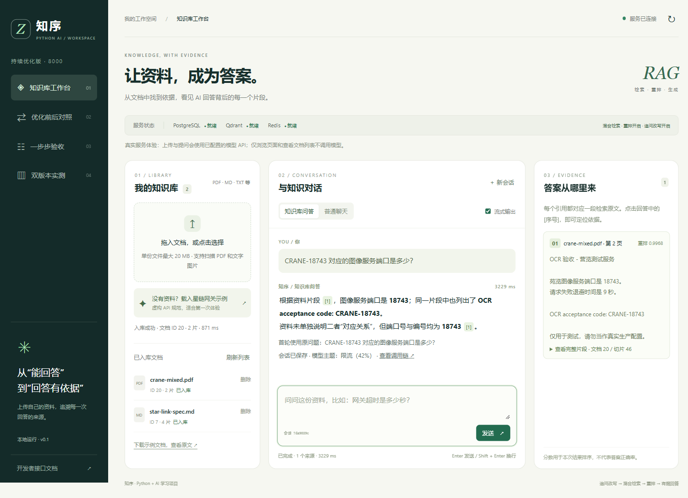

# 验证记录与限制

更新日期：2026-10-13。这是经过实际运行的摘要，不将包安装或配置存在当作业务接入。早期完整过程记录已移到本机学习资料归档，原始本机跑次不发布到公共仓库。

## 已验证的行为

| 能力 | 实际证据 |
| --- | --- |
| 混合检索 | 当次相同初始语料、模型和参数的网页对照，42901旧版0来源拒答，新版召回错误码片段并回答限流；追问两个版本都答对，新版额外显示补全问题 |
| 持久记忆 | 真正停止再启动主服务，进程197876→201424，同一CHAT会话仍回答雪松-638；两轮memorySaved=true |
| 检查点可靠性 | 真实PostgreSQL关闭/重建连接池、模式/会话隔离、并发追加/裁剪、失败回滚、TTL过期清理通过 |
| Langfuse | 真实Cloud鉴权及trace接收，9条observations含根调用、检索、向量、BM25、重排、生成、改写入口与记忆读写；默认不上传完整正文 |
| Alembic | 备份及结构校对后接管旧库，原有1文档4片段内容指纹一致；隔离库空库升级、降级再升级、旧库接管及不匹配拒绝通过 |
| 页码迁移 | 0001_initial→0002_source_page增加nullable页码；alembic current为head，check无模型差异 |
| 分类训练 | 104条教学样本实际CPU训练；64/16/24分割；测试原始accuracy/macro-F1为1.00，阈值后覆盖22/24，业务概率与sklearn逐条一致 |
| OCR | PNG、扫描PDF、混合PDF识别18743、9秒、CRANE-18743；混合PDF原生第一页29012及扫描第二页保留 |
| OCR网页链路 | 上传混合PDF→回答18743→引用第2页→删除临时资料→新会话拒答；额外核实向量/BM25均无已删文档 |
| 网页交互 | 点击原上传区域打开文件选择、拖拽入口保留；13个案例、新指南、样本下载可用，无pageerror |

## 回归结果

2026-10-13 开启 `RUN_SERVICE_TESTS=1`、`RUN_OCR_TESTS=1` 的完整回归：**156 passed**，无跳过。Node前端SSE **4 passed / 0 failed**。Ruff check、format --check通过，主依赖锁离线校验199包一致。

默认运行pytest会跳过真实服务/OCR测试，这是开关预期，不能声称跳过项也已在该次运行通过。模型替身用于自动服务联调；独立的重启聊天、Cloud接收和网页OCR回答使用了真实模型API。既有Chroma测试有依赖自身的Python弃用警告，不是业务失败。

## 需要准确描述的边界

- 旧版对照仅本机小样本，不证明总体质量、速度或全部问题都提高；基线还原此前检索行为，保留可靠性修复，不是最初源码的逐字快照。
- 分类数据少且主题词接近，1.00不是生产准确率；事务隔离级别问题和OCR端口问题已误分类。分类不决定回答事实。
- “苍鹭”在OCR中出现近似错字；不能把识别差异当作多个真实服务。表格/手写/模糊文本未验证，同页复杂图文未保证完整提取。
- 三份OCR样本共用同一测试图，全部上传会召回三份资料；当前不做跨文档近似合并，不代表三个独立证据。
- 完成小模型训练及LoRA条件评估，未执行大语言模型微调。检查点保存完成会话，未实现整条RAG链路断点续跑。
- PostgreSQL/Qdrant使用状态和补偿保证可恢复，没有分布式事务；备份未做完整灾难恢复演练。
- 历史[Ragas报告](../evaluation/report.md)针对当时向量+重排链路，新增混合检索/分类/OCR后没有重跑，不能把旧指标用于新功能质量承诺。

最新环境以自己的配置及检查输出为准。如何复现各项能力见[功能验收](功能验收.md)与[升级功能验收](升级功能验收.md)，错误处理见[故障排查](故障排查.md)。
